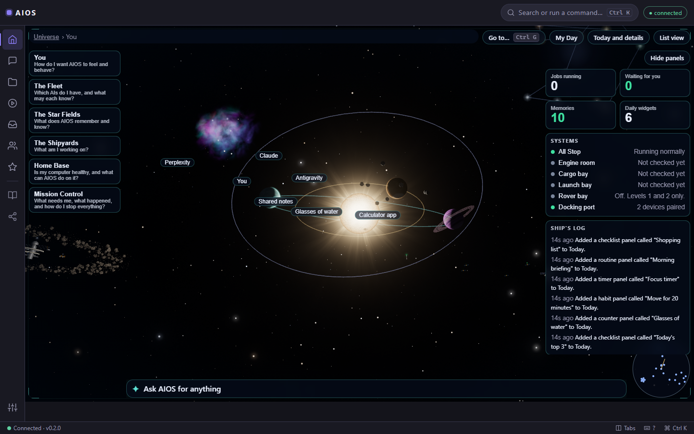
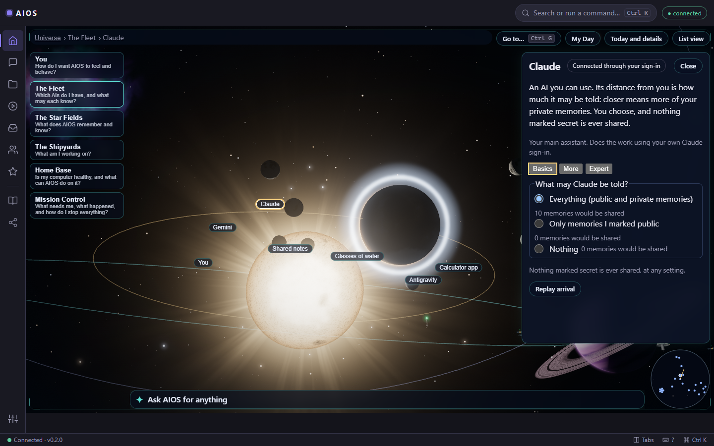
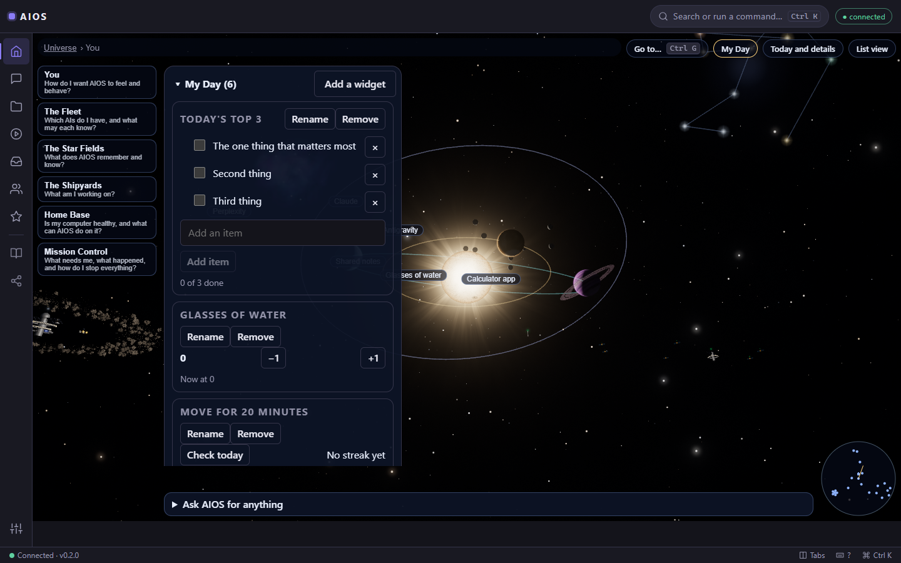
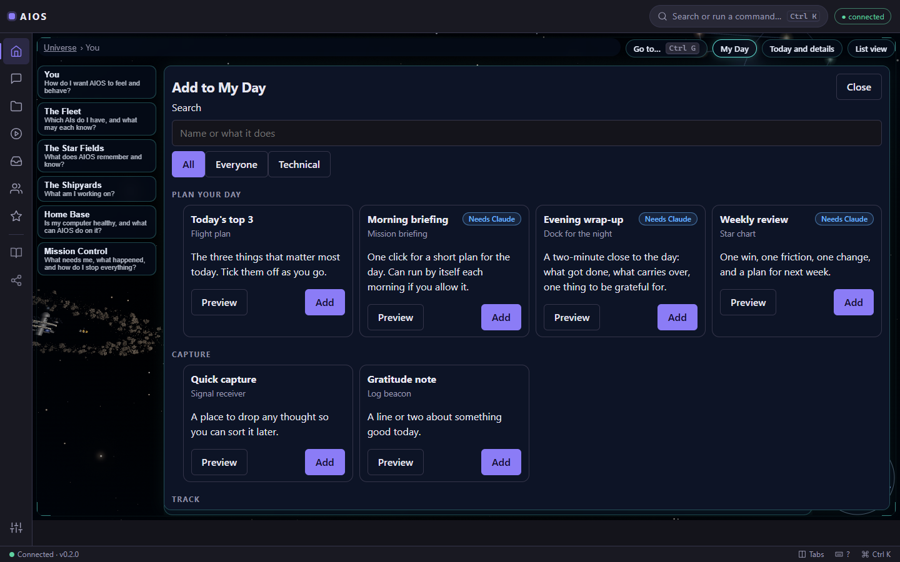
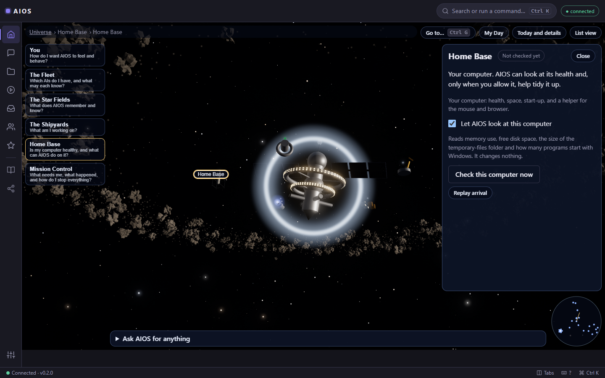
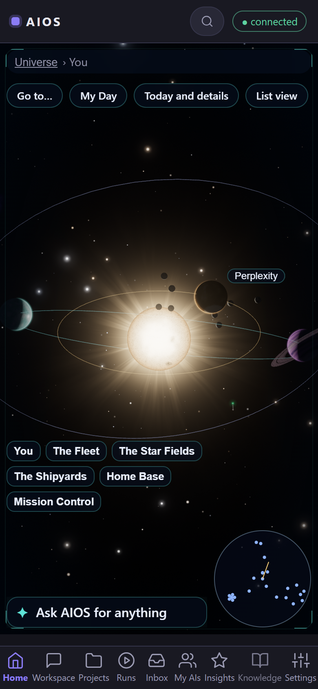

# AIOS

**Your AI, as a universe you can see, fly through and run.** AIOS is a local-first workspace that puts every AI you use, everything it remembers, your projects and your computer's health into one interactive 3D space. It runs on your own machine, uses your own sign-ins, and asks before it does anything that matters.

<p align="center">
  
</p>

> **Status: early personal project (v0.3, one author).** Built for one user on Windows 11. It has not had an external security review. Do **not** expose it to the public internet. See "Safety model" and "Known limits".

## The idea in one minute

Most AI tools are a text box. AIOS is a place.

| In the universe | What it really is |
|---|---|
| **You** (the sun) | Your preferences, privacy and how much AIOS learns |
| **Planets** | The AIs you use (Claude, Gemini, Perplexity, Antigravity). The closer a planet is, the more of your memories it may be told |
| **Moons** | Ready-made skills that belong to an AI |
| **Stars and clouds** | Everything AIOS remembers, plus old chats you imported |
| **Stations and shuttles** | Your projects and the jobs running on them |
| **Probes** | Small daily widgets you add yourself (see below) |
| **Comets** | Things waiting for your approval |
| **Home Base** | Your computer's health, and a helper for the mouse and browser |
| **All Stop** | One red button that stops AIOS from starting anything new |

Every object has a plain-words card that says what it is, with its settings in three levels (**Basics**, **More**, **Expert**). Nothing changes without you, and changes can be undone.

<p align="center">
  
</p>

## Travel

Drag to look around, scroll to move closer, or use the **travel dock** to fly to a region: *You*, *The Fleet*, *The Star Fields*, *The Shipyards*, *Home Base*, *Mission Control*. **Go to** (Ctrl+G) finds anything by name, the **radar** shows where everything is, and every object has a link you can bookmark. Prefer text? **List view** is the whole universe as a plain list, and calm mode turns the motion off.

When you add something new, it arrives: probes launch from the Shipyards, memory clouds flash into being, planets condense out of dust. A one-line caption says what happened, you can skip it, and an optional soft sound is off until you turn it on.

## Daily widgets: your Day, ready-made

**My Day** is a dock of small panels you pick from a catalog and make your own. Nothing needs a calendar, an email account or a bank. Everything lives on your computer.

<p align="center">
  
</p>

- **Plan your day:** Top 3, Morning briefing, Shutdown wrap-up, Weekly review
- **Capture:** Quick capture, Gratitude
- **Track:** Water, Move, Read, Sleep, Budget (typed in by you)
- **Focus:** Focus timer
- **Lists:** Shopping, Reading, Meals
- **For technical work:** Stand-up notes, Error log, Review queue, Release checklist

Routines (the briefing, wrap-up and weekly review) run a saved request through the single prompt box, on demand or on a schedule you allow, using your own Claude plan. They run at most once a day, and never while All Stop is on.

<p align="center">
  
</p>

## Keep your computer healthy

**Home Base** looks at memory, disk space, the temp folder and start-up programs, explains each finding in plain words, and shows you how to fix it with Windows' own screens. AIOS reads; it does not tidy behind your back. A fixed list of things it will never do (registry, services, drivers, antivirus, deleting your files, installing software) is refused in code.

<p align="center">
  
</p>

**The Rover** (mouse and browser helper) is opt-in per task, always has a visible Stop, and has a code-enforced block list (banking, password managers, payments, admin consoles). Today it can **look** at a window and **guide** you with numbered steps. It does not click or type for you. Controlling a browser or the screen is not built; see `docs/universe-spec.md` for what would have to be proven first.

## Everything else AIOS does

- **Workspace:** talk to real Claude Code about a project. *Ask* is read-only; *Make changes* edits an isolated copy, never your folder. You see the diff, AIOS runs your tests only after you approve that exact command, an independent reviewer session checks the revision, and AIOS (not a model) decides READY or NOT READY.
- **One prompt for any task:** type a request; AIOS shows the steps it will take and the ones it leaves out, then starts. A question gets an answer, a letter becomes a draft, and only a request to change a project builds, checks and reviews.
- **Start to finish:** one request carried through build, your check, review, corrections and a plain-words result.
- **Memory:** a markdown vault is the source of truth, with a rebuildable search index, a graph, daily notes, and a review queue for anything AIOS suggests remembering.
- **Run engine:** queued, running, awaiting approval, blocked, succeeded or failed, with deadlines, limits, and a rule that side effects with an unknown outcome are never replayed automatically.
- **Approvals bound to the exact action**, single use, expiring.
- **Clients:** the web app (an installable PWA) and a Capacitor Android shell, tested on an emulator.

<p align="center">
  
</p>

## Safety model (read this)

- The server binds to **loopback only**. Remote use is intended through a private network path plus HTTPS plus the app's own device login (`docs/mobile-remote-access.md`).
- AIOS never reads, copies or stores provider OAuth tokens or API keys and makes no paid API calls by default. Claude runs through the unmodified Claude Code CLI with your own sign-in.
- Private state (database, vault, imported history, backups, pictures) lives **outside** this repository.
- Imported text, notes and repository contents are untrusted data, never instructions.
- Safety is enforced in code (path guards, approvals, limits, block lists), not by asking a model nicely. Path checks are application-level guards, **not an OS sandbox**.
- Gemini CLI is unsupported. Antigravity is a manual hand-off. Gemini and Perplexity are copy and paste only. Anything mocked or untested is labelled as such.

## Quick start (Windows, PowerShell)

```powershell
scripts\setup.ps1              # Python venv, dependencies, web build
scripts\start.ps1              # http://127.0.0.1:8765  (state in ..\aios-state by default)
scripts\pair.ps1               # one-time code to sign a browser or phone in
.\.venv\Scripts\python.exe -m pytest        # backend tests
cd apps\web; npm test; npm run build        # web tests and production build
```

**One-click icon:** `scripts\setup.ps1` (or double-clicking `Install AIOS.cmd`) puts an **AIOS** icon on your Desktop and in the Start menu. To keep it on the taskbar, right-click the icon, choose *Show more options*, then *Pin to taskbar* (or *Pin to Start*). Windows does not let a program pin itself. To make the icons again later, run `scripts\create_shortcuts.ps1`. AIOS opens in its own Edge window when Edge is installed, otherwise in your default browser.

If you update AIOS while it is running, restart it (`scripts\stop.ps1`, then `scripts\start.ps1`) and refresh with Ctrl+Shift+R, or the universe will say it needs a restart.

Android: `scripts\android-build.ps1 -Variant debug` (see `docs/mobile-android.md`). Release signing keys are yours to create and are never committed.

## Known limits

- One author, one user, Windows 11. No external security review.
- The 3D view needs WebGL 2; without it AIOS draws a flat version of the same universe.
- The Rover cannot click, type or drive a browser. Those levels are specified but unverified.
- The skills' behavioural cases are specifications; they are not executed automatically.
- Real-Claude behaviour is shown by the demo scripts in `scripts/`, not by the automatic test suite, which uses a fake.

## Layout

`apps/api` FastAPI app and SQLite migrations · `apps/web` React client, WebGL renderer, PWA, Capacitor Android project, e2e scripts · `tests` backend tests · `scripts` setup, run, build, demo and scan helpers · `docs` architecture, API, mobile and handoff notes.

Start with `docs/universe-spec.md` (the design), `docs/architecture.md`, `docs/api-v1.md` and `docs/HANDOFF.md` (current state, honest about what is untested).

## License

MIT, see `LICENSE`. The software is provided as is, without warranty.

---

*Pictures in `docs/assets/` are generated from invented sample data by `apps/web/e2e/readme-shots.mjs`, never from a real AIOS.*
