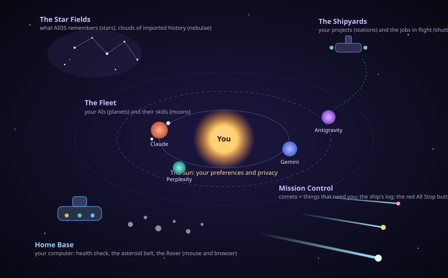

# AIOS Universe: design spec

Status: draft for your review, 2026-10-26. Decisions you made: WebGL with a fallback; Windows browser and the Android app; about 8 to 10 pages; extra checks are the five-second test, every setting has a home, safe control by design, and a build order with mockups.

## 1. The idea in one paragraph

AIOS is one place where every part of your digital life with AI lives, and you see it as a universe you can fly through. **You are the sun.** Your AIs are planets, what they know about you are stars, things waiting for you are comets, your projects are space stations, and your own computer is a home base with its own repair bay. Nothing in AIOS exists only in a menu: every piece is an object in space, you can fly to it, and each one has a panel where you configure it. The universe is not decoration on top of a dashboard. It is the interface, and it replaces the dashboard, the coding screens and the "second brain" with one experience.



## 2. Why this is needed

What you see today is not what this spec describes, for two separate reasons.

1. **Your browser showed no universe because the AIOS server it talks to was out of date.** The server process on port 8765 had been running since 10/25 8:49 PM with old code and had no `/universe` or `/dashboard`, so the screens loaded but had nothing to draw. It was restarted on 10/26 and now serves them. A new rule in this spec stops that class of problem: the app must say "the server is older than this screen" instead of silently showing nothing (risk table in section 10; built in phase 1 of section 11).
2. **Even running correctly, today's universe is small.** It shows you, your AIs, some memories and what is waiting, as a map you can only look at. It has no object for your projects, your computer, your imported history, your skills, or anything that controls the mouse or the browser, and most settings still live in separate menu screens.

This spec closes those gaps and makes the universe the whole product.

## 3. Principles

1. **The universe is the product.** Every feature has an object. If it has no object, it does not ship.
2. **One object, one piece of AIOS, one place to configure it.** Nothing is configured in two places.
3. **Plain words first.** Every object shows a short name and one sentence saying what it does. No jargon, no file paths, no model names unless you open the details.
4. **Travel, don't hunt.** You reach anything by flying to it, searching for it, or being taken to it.
5. **Safe by design.** AIOS explains before it acts, asks before anything with consequences, can always be stopped, and keeps a log. These are enforced in code, not by asking an AI to behave.
6. **It works without 3D.** A flat map and a plain list show the same objects, for older devices, screen readers and anyone who prefers them.
7. **Space theme everywhere.** Words, icons, sounds and motion all use the theme, but never at the cost of clarity: the plain name always comes first.

## 4. The universe: regions and levels

The universe has **five regions around the sun**, each answering one question a person actually has.

| Region | The question it answers | What lives there |
|---|---|---|
| **The Sun** (centre) | "How do I want AIOS to feel and behave?" | You: preferences, privacy, learning, the tour |
| **The Fleet** | "Which AIs do I have, and what may each know?" | Planets (AIs), moons (their skills) |
| **The Star Fields** | "What does AIOS remember and know?" | Stars (memories), constellations (topics), nebulae (imported history), wormholes (bring-ins), the beacon (sharing notes) |
| **The Shipyards** | "What am I working on?" | Stations (projects), shuttles (jobs in flight), probes (small panels) |
| **Home Base** | "Is my computer healthy, and can AIOS do things on it?" | The engine room, cargo bay, launch bay, asteroid belt, the Rover bay (mouse and browser), the docking port |
| **Mission Control** | "What needs me, what happened, and how do I stop everything?" | Comets (things that need you), the ship's log, the All Stop button |

You always know your level: **Universe** (all regions as glowing clusters with names), **Region** (its objects, labels on), **Object** (the camera parks beside it and its card opens), **Details** (the configuration panel).

## 5. What each object is

Each object has a plain name, a one-line job, a way of showing its state, and a set of settings. "Today" says whether something already exists in AIOS.

| Object | It represents | What the person reads | State is shown by | What you can change | Today |
|---|---|---|---|---|---|
| **Sun** | You | "You. Your preferences and privacy. Everything orbits you." | Glow strength = learning on or off | How much to see (Simple, Standard, Power), look and feel (theme, colour, text size, spacing, motion), learning, what to hide, replay the tour, offline and privacy options | Partly (a node with a panel) |
| **Planet** | One AI: Claude, Gemini, Perplexity, Antigravity | "Claude. Your main assistant. Does the work using your own Claude sign-in." Gemini: "Second opinions, by copy and paste." Perplexity: "Finds sources, by copy and paste." Antigravity: "Big coding jobs you hand over yourself." | Ring distance = how much it may be told; surface light = connected, waiting or offline | What it may know (everything, public only, nothing), which model (Claude), open its window (Gemini, Perplexity), its review habits | Yes (rings, levels) |
| **Moon** | A skill or ability an AI has | "Code review. A ready-made way of checking changes." | Lit = on, dim = off, flickers = a better version is proposed | Turn on or off, read what it can and cannot do, accept or decline an improvement | Not on the map |
| **Star** | One memory | "A thing AIOS remembers: you like short answers." | Shape = kind of memory; brightness = it was used and the work checked out; pulse = waiting for your yes | Edit, approve, forget, who may be told (public or private), which topic | Yes |
| **Constellation** | A topic or project's memories | "Cooking: 12 memories." | Lines join its stars | Rename, merge, share the whole group with one AI | Partly (groups by project) |
| **Nebula** | Imported history not yet read | "Old chats and notes AIOS has not sorted yet." | Cloud size = how much is waiting; clears as you review | Add a source, choose what to keep, review the queue, what to ignore | Pipeline yes, not on map |
| **Wormhole** | Bringing memories in from another AI | "Bring in what ChatGPT already knows about you." | Open when a paste is waiting | Pick the source, copy the request, paste the answer, review | Yes (paste) |
| **Beacon** | Notes you chose to share outside AIOS | "Shared notes. Only what you marked." | Pulses when a share is ready | Choose notes, preview, export | Yes (export) |
| **Station** | A project folder | "Calculator app. Your code, kept safe." | Lights = a job is running; scaffolding = waiting on you | Folder, how AIOS checks changes, how many fix-ups, apply rules, models | Projects screen; not on map |
| **Shuttle** | A job in flight | "Fixing the add bug. Step 2 of 4." | Flies station to planets; colour = working, waiting, done | Pause, cancel, retry, limits | Runs screen; not on map |
| **Probe** | A small panel or helper | "Shopping list." | Blinks when something changed | Add, edit, remove (fixed kinds only) | Yes (panels) |
| **Comet** | Something that needs you | "Approve running your tests." | Tail length = how long it has waited; colour = urgency | How you are told, snooze, ask me less | Yes |
| **Ship's log** | Everything AIOS did, and replays | "What AIOS did, in plain words." | Newest entries glow | Filter, replay a job, keep for how long | Yes (receipts, replay) |
| **All Stop** | Pause everything | A red beacon: "Stop everything now." | Steady red = paused | One tap on, one tap off | Yes |
| **Home Base** | Your computer, with modules | "Your computer. Health, space, start-up, and a helper that can use the mouse and browser." | Hull lights per module | See below | Health check only |
| **Asteroid belt** | Clutter on your computer | "Things slowing your PC. Each rock is one." | Rock size = how much it matters | Explain, show me how, or fix with approval | Four read-only findings |

**Moons, constellations and nebulae** keep the sky from being cluttered: they appear only when you fly close to their parent.

## 6. How you travel

You should never have to know where something is. Eight ways to get to any object:

1. **Click or tap it.** The camera flies there in about a second and parks beside it. With "reduce motion" on, it jumps.
2. **Region buttons** along the bottom (Sun, Fleet, Star Fields, Shipyards, Home Base, Mission Control) warp you straight to a region.
3. **Go to…** (magnifier, or Ctrl+K). Type a name or a need: "Gemini", "my memories", "free up space", "mouse", "privacy". The search knows plain-word synonyms and flies you to the best object.
4. **The radar** in the corner shows the whole universe and a "you are here" ping. Click anywhere on it to warp.
5. **Back and Home.** A breadcrumb (Universe › Home Base › Rover bay) with Back, Up and Home (key `0`), so you are never lost.
6. **Guided flights.** A strip at the top offers the next sensible trip: "3 things need you: fly to the first comet", "Check my computer", "Meet your AIs". The first-run **Captain's tour** is a guided flight with seven stops.
7. **Links from anywhere.** Every object has an address (`#/universe/<id>`), so the browser's Back button works, you can bookmark an object, and every other screen's items say "Show in the universe". A comet in a notification flies you to it.
8. **Keyboard and touch.** Tab visits objects region by region and Enter flies; arrows turn, plus and minus zoom, Esc goes up a level. On a phone: tap to fly, drag to look, pinch to zoom, double-tap to open settings. A "Universe as a list" toggle gives screen-reader users the same objects as a plain list.

**On arrival** the label becomes the **object card**, always in the same layout (figure 1): the plain name, one sentence on what it does, one sentence on its state right now, and three buttons: **Configure**, **Ask AIOS about this**, **Back**. A "Why is this here?" link explains the object in plain words.

```
 Figure 1: the object card (right side on a wide screen, bottom sheet on a phone)
 +--------------------------------------------+
 |  (planet icon)  Gemini                     |
 |  Second opinions, by copy and paste.       |
 |  Right now: may be told 12 public memories |
 |  [ Configure ]  [ Ask AIOS about this ]    |
 |  [ Back to the Fleet ]   Why is this here? |
 +--------------------------------------------+
```

## 7. How you configure an object

Every object opens the same kind of panel, so a person who has configured one has learned them all.

1. **Basics.** At most four controls in plain words, such as "What may Gemini be told? Everything / Only things I marked public / Nothing". Most people never leave this tab.
2. **More.** The rest, grouped, with a one-line explanation under each control.
3. **Expert.** The raw settings for technical users. Everything here also exists in Basics or More in plain words, or is clearly marked advanced.

Rules that apply to every object:

- **Preview before power.** Anything about privacy or power shows what would change first: "This lets Gemini see 12 of your memories. Show me which." Raising power asks you to hold a button for a moment (the existing vault door).
- **The scene reacts.** Changing what Gemini may know moves its planet to another ring. Forgetting a memory dims the star. You see the effect, not just a saved message.
- **Undo and log.** Reversible changes show an undo toast; every change is written to the ship's log.
- **Presets.** Each region and the whole universe have three presets, **Playing it safe**, **Balanced**, **Hands-off**, each showing exactly what it will change before you apply it.
- **Ask AIOS about this.** Opens the one-prompt box with the object as context: "Explain this to me" or "What would you recommend?" It only explains and suggests; any change is still made in the panel.
- **Where settings live.** Each object type declares a typed schema (names, plain labels, help text, allowed values, which are safe to change). The panel is drawn from the schema; the server validates every value; unknown fields are rejected; no secret is ever a setting.

```
 Example schema (planet)               Example schema (Rover bay)
 sharing_level: none|public|private    enabled: false          (off until you turn it on)
 model: account-default|sonnet|opus    allowed_apps: []        (named, never "all")
 open_window: button (copy-and-paste)  max_minutes: 10
 review_habit: always|big-jobs|never   needs_approval_for: [send, buy, delete, install]
```

### Every setting has a home

Nothing in today's AIOS may be left without an object. This table is the checklist; a setting not listed here may not exist.

| Today's setting or feature | Home (object, tab) |
|---|---|
| Theme, accent colour, text size, spacing, note font, reading width, reduce motion | Sun, Look and feel |
| How much to see (Simple, Standard, Power); hidden menu sections and cards | Sun, How much to see |
| 3D or flat map; the radar; sound | Sun, The map |
| Replay the tour | Sun, Captain's tour |
| Learning on or off | Sun, Learning |
| Offline summaries, unsent-draft behaviour | Sun, Privacy and offline |
| What each AI may be told; Claude's model; open Gemini or Perplexity | Planet, Basics |
| Skills and proposed skill improvements | Moon |
| Approve, edit, forget a memory; who may be told it | Star |
| Topic groups and tags | Constellation |
| Imported history sources and the review queue | Nebula |
| Bring in from another AI (paste) | Wormhole |
| Publish chosen notes | Beacon |
| Register a project; its check command; fix-up limit; applying a change | Station |
| Runs, retries, cancels, the start-to-finish workflow and its limits | Shuttle |
| Small panels (counter, checklist, note) | Probe |
| Approvals, blocked work, suggested memories | Comet |
| Receipts, job replay | Ship's log |
| Pause everything | All Stop |
| Health check, its schedule and thresholds | Home Base, Engine room |
| Disk space and temporary files | Home Base, Cargo bay |
| Programs that start with Windows | Home Base, Launch bay |
| Mouse and browser control | Home Base, Rover bay |
| Server address, paired devices, notifications, backups, diagnostics | Home Base, Docking port |

## 8. Home Base: your computer

Home Base is where AIOS stops being about AIs and starts helping with the machine in front of you. It is Windows-first: on other systems it shows what it can read and explains the rest. The Android app shows status, takes approvals and has Stop, but cannot run Home Base actions on the phone.

### 8.1 Helping you optimize your system

The **health check** (exists today, read-only) reads memory use, free disk space, the size of the temporary-files folder and the number of start-up programs, and explains them in plain words. This spec turns that into a place you can fly to.

- **The asteroid belt** circles Home Base. Each rock is one finding; a bigger rock matters more. Click one and AIOS does three things in order: **Explain** (what it is and why it matters, with the number it is based on), **Show me how** (numbered steps and a screenshot to do it yourself), **Do it for me** (only where it is safe and reversible, with approval).
- **The modules** group the findings: **Engine room** (speed: memory, heavy programs), **Cargo bay** (space: temporary files, recycle bin, the biggest folders shown as a map, nothing opened), **Launch bay** (start-up programs), **Docking port** (connections, devices, backups).
- **Weekly check-up.** Optional, off until you turn it on; produces a short "your computer this week" card and a log entry.

What AIOS may do, strictly by safety class:

| Class | Examples | Rule |
|---|---|---|
| Read only | Memory, disk, start-up list, big-folder map, pending Windows restart | Allowed once the health-check ability is on; changes nothing |
| Reversible | Turn a start-up program off or on; clear the temporary-files folder through Windows' own cleanup | Needs approval each time, shows exactly what changes and the space gained, and says how to undo; recorded in the log |
| Never | Delete your documents, photos or downloads; edit the registry beyond the start-up on/off switch; uninstall programs; touch passwords or browser history | Not offered, and refused in code even if asked |

Closing a heavy program is offered only as an ordinary request to close it, with the program named and approval needed; AIOS never force-kills anything.

### 8.2 Taking control of the mouse or browser: the Rover bay

The **Rover** is the helper that can use the mouse and the browser for you. It lives in the Rover bay on Home Base, **off by default**, and everything here is opt-in.

First, what is really possible. These facts come from Anthropic's own documentation and decide which levels can exist in AIOS:

- **Claude in Chrome** (browser control from Claude Code) works with Chrome and Edge on Windows, uses your signed-in browser in a visible window, pauses at logins and CAPTCHAs, and takes site permissions from the extension. It is documented for interactive Claude Code sessions (`claude --chrome`); whether it works in the quiet "print" mode AIOS uses to run Claude is **not documented** and must be tested.
- **Computer use from the Claude Code command line is macOS only** and needs an interactive session, so it cannot be AIOS's route on Windows.
- **Computer use on Windows exists in the Claude Desktop app** (Pro or Max plan, per-app approval, browsers view-only, terminals click-only). Anthropic documents no way for another program to start or drive it.

AIOS rules also apply: Claude is run only through its own command line with your own sign-in, and no paid API keys are used. So the Rover has **four levels**, each clearly labelled by how it works:

| Level | What it does | How | Status |
|---|---|---|---|
| **1. Look** | Takes a picture of one window you choose and explains it in plain words ("What is this error?") | AIOS captures the window locally; Claude reads the picture | Technique tested in a spike; capture helper to build |
| **2. Guide** | Shows you what to click, step by step, on annotated screenshots, and you do the clicking | AIOS only | To build |
| **3. Browser** | Opens a browser window and does a task on named sites while you watch | Claude in Chrome, started by AIOS in a visible Claude Code window with your task pre-filled; AIOS records that it was started and what you approved, but cannot see inside | Needs spike S2 |
| **4. Screen** | Uses the mouse and keyboard in apps you approve | Hand-off to Claude Desktop's computer use: AIOS writes the task and a permission checklist, you start it in Desktop; AIOS cannot drive or watch it | Hand-off only, like Antigravity |

The Rover is never described as more than it is: a hand-off is shown as **"You start this"**, never as automatic.

**The Rover safety contract** (applies to every level AIOS starts or can see):

- Off until you turn it on, then **per task**: you name the app or sites and a time limit (default 10 minutes).
- While active, the whole universe wears a visible **"Rover active"** ring, and the Rover bay shows what it is doing.
- **Stop** is always reachable: a big button, the All Stop beacon, and a keyboard shortcut. Stopping ends the session and writes the log.
- A fixed **block list** enforced in code, not in a prompt: banking and payment pages, password managers, system settings, and anything that looks like a login or payment field.
- **Approval for the irreversible**: send, buy, delete, install, submit. Each shows what it will do first.
- Pictures stay on your computer, with secrets blurred before anything is saved, and a job can be replayed from the ship's log.
- The Rover cannot be started by an AI on its own, by a note, a web page, or a pasted answer. Only you, in the panel.

## 9. Options for average users

- **Guided flights and a captain's tour** instead of a manual.
- **Presets** (Playing it safe, Balanced, Hands-off) instead of dozens of switches, always showing the effect first.
- **Plain words everywhere**, with a glossary one tap away, and **Ask AIOS about this** on every object.
- **Safe defaults**: every power starts off, shared AIs start with the least access, and every change can be undone.
- **One prompt box** for any task, which already decides which steps a task needs and which to leave out.
- **Three ways to see it**: 3D universe, flat map, plain list. Plus reduced motion, high contrast, large text and full keyboard use.
- **Calm by default**: motion is slow, sounds are off, nothing flashes more than three times a second, and Simple mode shows only the sun, the Fleet and Mission Control until you ask for more.

## 10. How it is built

**Rendering.** WebGL 2 through Three.js draws the scene: glowing instanced stars, textured planets with rings, comet trails, a starfield backdrop, and a light bloom. The existing dependency-free SVG engine stays as the **fallback** and as the flat map, so the universe works when WebGL is unavailable, the context is lost, or the person prefers it. Both draw from the same scene description so they never disagree.

**Scene data.** A single server endpoint describes every object: id, type, region, plain name, one-line job, state sentence, a stable seeded position hint, and the schema reference. Positions are deterministic, so your universe looks the same tomorrow.

**Configuration.** Panels are generated from each object type's schema and call the existing, already-guarded endpoints. Nothing new gets power by being an object: the object model only organises what is already controlled in code (approvals, path guards, limits, the pause switch).

**Performance budget** (checked in tests): 60 frames a second on a typical integrated GPU at 1080p; 30 on the Android WebView; fewer than 200 draw calls; thousands of memories as one instanced group; levels of detail so distant objects are dots and labels fade in as you approach; the scene stops drawing when the tab is hidden.

**Accessibility.** Every object also exists as a real button in a hidden list, with the same plain name and sentence. Shape and motion carry meaning as well as colour. Focus rings are visible in the scene.

**Platforms.** Windows desktop browsers and the Android app (Capacitor WebView), with mouse, keyboard and touch. Home Base actions and the Rover run on the Windows computer through a small local helper that the browser page cannot start by itself.

**Testing.** Unit tests for layout and travel maths; screenshot checks in dark, light and phone sizes; automated accessibility checks; a performance budget test; an end-to-end flight test; and a real-Claude check for each Rover level that can run. Mocks are labelled as mocks.

**Risks and answers.**

| Risk | Answer |
|---|---|
| The server is older than the screen (what happened to you) | The app compares versions and says "restart AIOS" with a button, instead of showing an empty map |
| WebGL is heavy or broken on a device | Automatic fallback to the SVG map; a setting to force it |
| People find 3D confusing | Flat map and list views, Simple mode, labels always on, the radar, and the five-second test |
| Rover misuse or injection from page content | Opt-in per task, block list in code, approvals for the irreversible, visible ring, always-on Stop |
| The documented Rover routes change | Levels are separate modules; a level that stops working is hidden, not faked |

## 11. Build order

Each phase ends with a check that must pass before the next starts. Sizes are relative (S, M, L), not dates.

| Phase | What | Size | Exit check |
|---|---|---|---|
| **0. Today** | The sun, planets, stars, comets; rings and sharing; import; tour; companion windows; the one-prompt dashboard; the read-only health check | done | Already verified |
| **1. One model** | Object registry and schemas; the generic object card and configuration panel; move every setting in the table above into an object; the settings screen becomes a list view of the same objects; the version check ("restart AIOS") | L | Every row of the "every setting has a home" table is reachable from an object; no setting remains elsewhere |
| **2. Real 3D** | Three.js renderer, flights, radar, Go to, breadcrumb, deep links, list view, fallback parity | L | Performance budget met; flat, list and 3D show the same objects; the five-second test passes for the objects that exist |
| **3. Home Base** | Home Base on the map; asteroid belt from the health check; Explain and Show me how; reversible actions with approval; weekly check-up | M | Each action has a logged approval and an undo; "Never" actions are refused by tests |
| **4. The Rover** | Level 1 Look, level 2 Guide, the safety contract and Stop; then levels 3 and 4 only if spikes S2 and S3 pass | L | Stop works under test; blocked sites are refused; a real-Claude check for each level that is offered |
| **5. Work and knowledge objects** | Stations, shuttles, nebulae, moons, probes, beacon on the map | M | Every object type in section 5 exists |
| **6. Polish** | Sound, motion tuning, presets, accessibility audit, Android tuning | M | Five-second test and accessibility audit pass on all objects |

**Spikes to run first** (each answers one unknown before building on it): **S1** window capture and Claude reading it (technique tested, capture helper not built); **S2** does `claude -p --chrome` work, or only an interactive session; **S3** can a hand-off to Claude Desktop be made smooth without AIOS driving it; **S4** WebGL frame rate on a weak integrated GPU and the Android WebView; **S5** which Windows cleanup routes are safe and reversible without extra permissions.

## 12. How this spec is checked

Your done criteria:

| You asked | Where it is answered |
|---|---|
| A 3D interactive universe as the core of the UI | Sections 1, 4, 10 |
| What each type of object does and which piece of AIOS it is | Section 5 |
| How a user travels to each object | Section 6 |
| How each object is configured | Section 7 |
| Mouse and browser control for average users | Section 8.2, section 9 |
| System optimization for average users | Section 8.1, section 9 |

Your extra checks, each with a way to pass or fail:

- **Five-second test.** Show five non-technical people only an object's name and one-line job (no hover, no help). At least four of five can say what it does for each of the sixteen objects. Fails the object, not the person.
- **Every setting has a home.** A script lists today's settings and features and fails the build if any is missing from the section 7 table or maps to two objects.
- **Safe control by design.** Tests prove the Rover cannot start without you, shows its ring, stops on Stop, refuses the block list, and asks before irreversible steps; and that "Never" cleanup actions are refused.
- **Build order and mockups.** Section 11 and the two figures above.

## Appendix: one-line glossary

Sun: you. Planet: an AI. Moon: a skill. Star: a memory. Constellation: a topic. Nebula: imported history. Wormhole: bringing memories in. Beacon: shared notes. Station: a project. Shuttle: a job in flight. Probe: a small panel. Comet: something that needs you. Ship's log: what AIOS did. All Stop: pause everything. Home Base: your computer. Asteroid belt: clutter slowing it. Rover: the helper that uses the mouse and browser, only when you allow it.

Sources: [computer use in the CLI](https://code.claude.com/docs/en/computer-use), [Claude in Chrome](https://code.claude.com/docs/en/chrome), [computer use in the Desktop app](https://code.claude.com/docs/en/desktop), [computer use safety guide](https://support.claude.com/en/articles/14128542).
